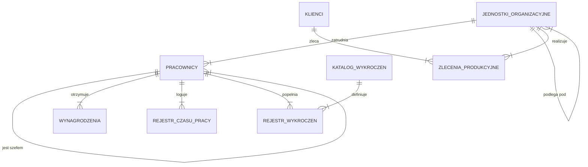

# **Wielton S.A.**

## **Kompletna Dokumentacja Techniczna Bazy Danych**

**Data:** 2025-12-22  
**Autor:** Piotr Straszak, Paweł Lorenc  
**Wersja:** 1.0 (Enterprise Edition - Extended)

---

## **Spis Treści**

1.  [Wstęp i Cel Systemu](#1-wstęp-i-cel-systemu)
2.  [Struktura Bazy Danych (Schema Reference)](#2-struktura-bazy-danych-schema-reference)
    *   [2.1. Tabela: pracownicy](#21-tabela-pracownicy)
    *   [2.2. Tabela: jednostki_organizacyjne](#22-tabela-jednostki_organizacyjne)
    *   [2.3. Tabela: rejestr_czasu_pracy](#23-tabela-rejestr_czasu_pracy)
    *   [2.4. Tabela: wynagrodzenia](#24-tabela-wynagrodzenia)
    *   [2.5. Tabela: zlecenia_produkcyjne](#25-tabela-zlecenia_produkcyjne)
    *   [2.6. Tabela: klienci](#26-tabela-klienci)
    *   [2.7. Tabela: rejestr_wykroczen](#27-tabela-rejestr_wykroczen)
    *   [2.8. Tabela: katalog_wykroczen](#28-tabela-katalog_wykroczen)
    *   [2.9. Widoki Systemowe (Views)](#29-widoki-systemowe-views)
3.  [Logika Biznesowa (Business Logic Layer)](#3-logika-biznesowa-business-logic-layer)
    *   [3.1. Procedury Składowane](#31-procedury-składowane)
    *   [3.2. Funkcje Analityczne](#32-funkcje-analityczne)
    *   [3.3. Wyzwalacze (Triggers)](#33-wyzwalacze-triggers)
4.  [Procesy Biznesowe (Business Workflows)](#4-procesy-biznesowe-business-workflows)
5.  [Model Bezpieczeństwa (Security & Roles)](#5-model-bezpieczeństwa-security--roles)
    *   [5.1. Rola Administratora](#51-rola-administratora)
    *   [5.2. Rola Managera HR](#52-rola-managera-hr)
    *   [5.3. Rola Managera Produkcji](#53-rola-managera-produkcji)
    *   [5.4. Rola Księgowości](#54-rola-księgowości)
    *   [5.5. Rola Audytora](#55-rola-audytora)


---

## **1. Wstęp i Cel Systemu**

System **"Zarządzania dla Wielton S.A."** to zaawansowane rozwiązanie klasy ERP (Enterprise Resource Planning) oparte na silniku relacyjnej bazy danych PostgreSQL. Został zaprojektowany w celu kompleksowej obsługi kluczowych procesów w przedsiębiorstwie produkcyjno-usługowym o dużej skali działania.

Główne cele systemu to:
*   **Centralizacja danych kadrowych:** Przechowywanie kompletnych akt osobowych pracowników, historii zatrudnienia oraz danych kontaktowych w jednej, spójnej strukturze.
*   **Automatyzacja płac (Payroll):** Eliminacja błędów ludzkich poprzez zastosowanie procedur składowanych do wyliczania wynagrodzeń na podstawie ewidencji czasu pracy (RCP) oraz systemu kar i premii.
*   **Zarządzanie Produkcją:** Monitorowanie cyklu życia zleceń produkcyjnych od momentu przyjęcia zamówienia, poprzez estymację czasu realizacji, aż po finalizację i rozliczenie finansowe.
*   **Bezpieczeństwo i Audytowalność:** Zastosowanie ścisłej kontroli dostępu (RBAC - Role Based Access Control) oraz mechanizmów blokady modyfikacji danych historycznych (Compliance).

System jest przygotowany do pracy pod dużym obciążeniem (High Load Ready) i posiada wbudowane mechanizmy optymalizacji zapytań poprzez indeksy i widoki zmaterializowane (tam gdzie to konieczne).

---

## **2. Struktura Bazy Danych (Schema Reference)**

Szczegółowy opis fizycznej struktury tabel w schemacie `public`. Każda tabela została zaprojektowana zgodnie z zasadami normalizacji (3NF) w celu zapewnienia integralności danych.

### **Diagram Relacji (ERD)**



### **2.1. Tabela: `pracownicy`**

Centralna kartoteka systemu. Zawiera dane wrażliwe (PII - Personally Identifiable Information), dlatego dostęp do niej jest ściśle reglamentowany.

#### **Definicja SQL**
```SQL
CREATE TABLE pracownicy (
    pracownik_id INTEGER PRIMARY KEY,
    imie VARCHAR(50) NOT NULL,
    nazwisko VARCHAR(50) NOT NULL,
    pesel VARCHAR(11) UNIQUE NOT NULL,
    data_urodzenia DATE NOT NULL,
    adres VARCHAR(255),
    telefon_kontaktowy VARCHAR(15) UNIQUE,
    email_sluzbowy VARCHAR(100) UNIQUE,
    stanowisko VARCHAR(100) NOT NULL,
    jednostka_id INTEGER NOT NULL,
    data_zatrudnienia DATE NOT NULL, 
    data_zwolnienia DATE,
    typ_umowy VARCHAR(50) NOT NULL,
    wymiar_etatu NUMERIC(3,2) NOT NULL,
    numer_konta_bankowego VARCHAR(26) UNIQUE,
    przelozony_id INTEGER,
    aktywny BOOLEAN DEFAULT TRUE NOT NULL,
    stawka_godzinowa NUMERIC(10,2) NOT NULL
);

ALTER TABLE pracownicy ADD CONSTRAINT fk_jednostka_id_pracownicy
FOREIGN KEY (jednostka_id) REFERENCES jednostki_organizacyjne(jednostka_id);
```

#### **Opis Kolumn**
| Kolumna | Typ Danych | Opis Funkcjonalny |
| :--- | :--- | :--- |
| `pracownik_id` | `INTEGER` | Unikalny identyfikator pracownika (Klucz Główny). |
| `imie` | `VARCHAR(50)` | Pierwsze imię pracownika. |
| `nazwisko` | `VARCHAR(50)` | Nazwisko pracownika. |
| `pesel` | `VARCHAR(11)` | Numer PESEL. Unikalny w skali bazy. Podlega walidacji sumy kontrolnej. |
| `telefon_kontaktowy` | `VARCHAR(15)` | Numer telefonu służbowego. Format jest weryfikowany wyrażeniem regularnym. |
| `jednostka_id` | `INTEGER` | Klucz obcy do tabeli jednostek organizacyjnych. Wskazuje dział, w którym pracownik jest zatrudniony. |
| `aktywny` | `BOOLEAN` | Flaga statusu. `TRUE` oznacza pracownika zatrudnionego, `FALSE` - archiwalnego (zwolnionego). |
| `stawka_godzinowa` | `NUMERIC(10,2)` | Podstawa do wyliczeń płacowych. Kwota Brutto za 1 godzinę pracy. |

#### **Przykładowe Dane**
| pracownik_id | imie | nazwisko | pesel | stanowisko | stawka_godzinowa |
| :--- | :--- | :--- | :--- | :--- | :--- |
| 101 | Anna | Nowak | 85010112345 | Księgowa | 45.00 |
| 102 | Jan | Kowalski | 90051254321 | Operator Maszyny | 32.50 |
| 103 | Piotr | Zieliński | 78121298765 | Kierownik Zmiany | 55.00 |

---

### **2.2. Tabela: `jednostki_organizacyjne`**

Odzwierciedla strukturę hierarchiczną firmy (drzewo organizacyjne).

#### **Definicja SQL**
```SQL
CREATE TABLE jednostki_organizacyjne (
    jednostka_id INTEGER PRIMARY KEY,
    nazwa_jednostki VARCHAR(100) UNIQUE NOT NULL,
    typ_jednostki VARCHAR(20) NOT NULL,
    adres VARCHAR(255),
    telefon VARCHAR(15) UNIQUE,
    jednostka_nadrzedna_id INTEGER
);

ALTER TABLE jednostki_organizacyjne ADD CONSTRAINT fk_jednostka_nadrzedna
FOREIGN KEY (jednostka_nadrzedna_id) REFERENCES jednostki_organizacyjne(jednostka_id);
```

#### **Opis Kolumn**
| Kolumna | Typ Danych | Opis Funkcjonalny |
| :--- | :--- | :--- |
| `jednostka_id` | `INTEGER` | ID Działu/Zespołu. |
| `nazwa_jednostki` | `VARCHAR` | Nazwa biznesowa (np. "Dział IT", "Księgowość"). |
| `typ_jednostki` | `VARCHAR` | Klasyfikacja strukturalna (np. "Centrala", "Oddział", "Sekcja"). |
| `jednostka_nadrzedna_id` | `INTEGER` | Auto-referencja (Self-Join) pozwalająca budować hierarchię (Dział podległy -> Dział nadrzędny). |

#### **Przykładowe Dane**
| jednostka_id | nazwa_jednostki | typ_jednostki | jednostka_nadrzedna_id |
| :--- | :--- | :--- | :--- |
| 1 | Zarząd Główny | Centrala | NULL |
| 2 | Pion Produkcji | Pion | 1 |
| 3 | Linia Montażowa A | Sekcja | 2 |

---

### **2.3. Tabela: `rejestr_czasu_pracy`**

Ewidencja obecności (RCP). Podstawa do naliczania wynagrodzeń zmiennych.

#### **Definicja SQL**
```SQL
CREATE TABLE rejestr_czasu_pracy (
    rejestr_id INTEGER PRIMARY KEY,
    pracownik_id INTEGER NOT NULL,
    data_pracy DATE NOT NULL,
    godziny_przepracowane NUMERIC(4,2) NOT NULL,
    godziny_nadliczbowe NUMERIC(4,2) DEFAULT 0.00 NOT NULL
);

ALTER TABLE rejestr_czasu_pracy ADD CONSTRAINT unikalny_czas_pracy_dziennie 
UNIQUE (pracownik_id, data_pracy);
```

#### **Opis Kolumn**
| Kolumna | Typ Danych | Opis Funkcjonalny |
| :--- | :--- | :--- |
| `data_pracy` | `DATE` | Dzień, którego dotyczy wpis. System blokuje dublowanie wpisów dla tego samego dnia i pracownika (CONSTRAINT UNIQUE). |
| `godziny_przepracowane` | `NUMERIC` | Liczba godzin faktycznie spędzonych w pracy. |

#### **Przykładowe Dane**
| rejestr_id | pracownik_id | data_pracy | godziny_przepracowane |
| :--- | :--- | :--- | :--- |
| 5001 | 102 | 2025-10-01 | 8.00 |
| 5002 | 102 | 2025-10-02 | 8.00 |
| 5003 | 102 | 2025-10-03 | 7.50 |

---

### **2.4. Tabela: `wynagrodzenia`**

Finansowe serce systemu. Tabela "Append-Only" (Dopisuj Tylko) przechowująca wygenerowane listy płac. Chroniona przed modyfikacją przez Trigger `trg_security_payroll`.

#### **Definicja SQL**
```SQL
CREATE TABLE wynagrodzenia (
    wynagrodzenie_id INTEGER PRIMARY KEY,
    pracownik_id INTEGER NOT NULL,
    okres_rozliczeniowy DATE NOT NULL,
    data_wyplaty DATE NOT NULL,
    placa_podstawowa NUMERIC(10,2) NOT NULL,
    premia_za_wyniki NUMERIC(10,2) DEFAULT 0.00 NOT NULL,
    kary_za_wykroczenia NUMERIC(10,2) DEFAULT 0.00 NOT NULL,
    calkowite_wynagrodzenie_brutto NUMERIC(10,2) NOT NULL,
    calkowite_wynagrodzenie_netto NUMERIC(10,2) NOT NULL
);

ALTER TABLE wynagrodzenia ADD CONSTRAINT check_wynagrodzenie_non_negative 
CHECK (calkowite_wynagrodzenie_brutto >= 0);
```

#### **Przykładowe Dane**
| wynagrodzenie_id | data_wyplaty | brutto | netto |
| :--- | :--- | :--- | :--- |
| 9001 | 2025-11-01 | 5400.00 | 3780.00 |
| 9002 | 2025-11-01 | 4200.00 | 2940.00 |

---

### **2.5. Tabela: `zlecenia_produkcyjne`**

Rejestr zamówień od klientów. Służy do planowania produkcji i prognozowania przychodów.

#### **Definicja SQL**
```SQL
CREATE TABLE zlecenia_produkcyjne (
    zlecenie_id INTEGER PRIMARY KEY,
    klient_id INTEGER NOT NULL,
    numer_zlecenia_klienta VARCHAR(50) UNIQUE NOT NULL,
    data_przyjecia_zlecenia DATE NOT NULL,
    przewidywana_data_realizacji DATE NOT NULL,
    data_faktycznej_realizacji DATE,
    nazwa_produktu VARCHAR(255) NOT NULL,
    ilosc INTEGER NOT NULL,
    cena_jednostkowa NUMERIC(10,2) NOT NULL,
    waluta VARCHAR(3) NOT NULL,
    czy_zakonczona BOOLEAN DEFAULT FALSE NOT NULL
);

ALTER TABLE zlecenia_produkcyjne ADD CONSTRAINT check_ilosc_positive CHECK (ilosc > 0);
```

#### **Opis Kolumn**
| Kolumna | Typ Danych | Opis Funkcjonalny |
| :--- | :--- | :--- |
| `numer_zlecenia_klienta` | `VARCHAR` | Zewnętrzny numer zamówienia (Business Key). |
| `przewidywana_data_realizacji` | `DATE` | Termin wyliczony przez algorytm predykcyjny w momencie przyjęcia zlecenia. |
| `data_faktycznej_realizacji` | `DATE` | Data rzeczywistego zakończenia produkcji. Jeśli `NULL`, zlecenie jest w toku. |

#### **Przykładowe Dane**
| zlecenie_id | produkt | ilosc | cena | status |
| :--- | :--- | :--- | :--- | :--- |
| 201 | Śruba M12 | 5000 | 0.50 | W Toku |
| 202 | Podkładka Stalowa | 20000 | 0.15 | Zakończone |

#### **Przykładowe Dane**
| klient_id | nazwa_klienta | nip | osoba_kontaktowa |
| :--- | :--- | :--- | :--- |
| 1 | Budex S.A. | 5250001234 | Marek Inżynierski |
| 2 | Auto-Moto-Fan | 1234567890 | Krzysztof Kierownica |
| 3 | Hurtownia "Stal-Met" | 9876543210 | Anna Metalowa |

---

### **2.6. Tabela: `rejestr_wykroczen`**

Log dyscyplinarny pracowników.

#### **Definicja SQL**
```SQL
CREATE TABLE rejestr_wykroczen (
    rejestr_wykroczenia_id INTEGER PRIMARY KEY,
    pracownik_id INTEGER NOT NULL,
    wykroczenie_id INTEGER NOT NULL,
    data_zdarzenia DATE NOT NULL,
    naliczona_kara NUMERIC(8,2) NOT NULL,
    opis_zdarzenia VARCHAR(500)
);
```

#### **Przykładowe Dane**
| rejestr_wykroczenia_id | pracownik_id | wykroczenie_id | data_zdarzenia | kara |
| :--- | :--- | :--- | :--- | :--- |
| 1 | 102 | 1 | 2025-10-15 | 50.00 |
| 2 | 105 | 2 | 2025-11-02 | 200.00 |

---

### **2.7. Tabela: `katalog_wykroczen`**

Słownik typów przewinień.

#### **Definicja SQL**
```SQL
CREATE TABLE katalog_wykroczen (
    wykroczenie_id INTEGER PRIMARY KEY,
    nazwa_wykroczenia VARCHAR(100) UNIQUE NOT NULL,
    opis VARCHAR(255),
    standardowa_kara_pln NUMERIC(8,2) NOT NULL
);
```

#### **Przykładowe Dane**
| ID | Nazwa | Kara |
| :--- | :--- | :--- |
| 1 | Spóźnienie > 15min | 50.00 PLN |
| 2 | Brak Odzieży Ochronnej | 200.00 PLN |
| 3 | Palenie w miejscu niedozwolonym | 500.00 PLN |

---

### **2.9. Widoki Systemowe (Views)**

#### **2.9.1. Widok: `raport_koszty_dzialow`**

Analityczny widok agregujący, służący do szybkiego raportowania kosztów pracowniczych w podziale na działy. Wykorzystywany przez Zarząd i Księgowość.

#### **Definicja SQL**
```SQL
CREATE OR REPLACE VIEW raport_koszty_dzialow AS
SELECT 
    j.nazwa_jednostki AS dzial,
    COUNT(p.pracownik_id) AS liczba_pracownikow,
    COALESCE(SUM(w.calkowite_wynagrodzenie_brutto), 0) AS suma_wyplat_brutto,
    ROUND(AVG(w.calkowite_wynagrodzenie_brutto), 2) AS srednia_wyplata
FROM jednostki_organizacyjne j
LEFT JOIN pracownicy p ON j.jednostka_id = p.jednostka_id
LEFT JOIN wynagrodzenia w ON p.pracownik_id = w.pracownik_id
-- Bierzemy pod uwagę tylko wypłaty z bieżącego roku (opcjonalnie)
WHERE w.data_wyplaty >= DATE_TRUNC('year', CURRENT_DATE)
GROUP BY j.nazwa_jednostki
ORDER BY suma_wyplat_brutto DESC;
```

---

## **3. Logika Biznesowa (Business Logic Layer)**

System przenosi ciężar obliczeń z aplikacji na silnik bazodanowy, co gwarantuje wydajność i spójność danych.

### **3.1. Procedury Składowane**

#### **3.1.1. `generuj_wyplaty_za_miesiac(rok, miesiac)`**
*   **Cel:** Masowe generowanie pasków płacowych dla wszystkich aktywnych pracowników.
*   **Algorytm Działania:**
    1.  Pobierz wszystkich pracowników z flagą `aktywny = TRUE`.
    2.  Dla każdego pracownika zsumuj godziny z tabeli `rejestr_czasu_pracy` dla zadanego miesiąca.
    3.  Zsumuj kary finansowe z tabeli `rejestr_wykroczen`.
    4.  Wylicz Brutto = (Godziny * Stawka) - Kary.
    5.  Wylicz Netto (uproszczone 70% Brutto).
    6.  Wstaw rekord do tabeli `wynagrodzenia`.
    7.  Zaloguj operację.

**Kod źródłowy:**
```SQL
CREATE OR REPLACE PROCEDURE generuj_wyplaty_za_miesiac(rok INT, miesiac INT)
LANGUAGE plpgsql AS $$
DECLARE
    -- Pobieramy rekord pracownika (w tym jego stawkę)
    pracownik RECORD;
    
    suma_godzin NUMERIC(10,2);
    suma_kar NUMERIC(10,2);
    wyplata_brutto NUMERIC(10,2);
    nowe_id INTEGER;
    start_date DATE;
    end_date DATE;
BEGIN
    start_date := MAKE_DATE(rok, miesiac, 1);
    end_date := (start_date + INTERVAL '1 month' - INTERVAL '1 day')::DATE;

    RAISE NOTICE 'Generowanie listy płac za okres: % - %', start_date, end_date;

    -- Pętla po pracownikach (pobieramy stawkę bezpośrednio stąd)
    FOR pracownik IN SELECT * FROM pracownicy WHERE aktywny = TRUE LOOP
        
        -- 1. Policz godziny
        SELECT COALESCE(SUM(godziny_przepracowane), 0) INTO suma_godzin
        FROM rejestr_czasu_pracy
        WHERE pracownik_id = pracownik.pracownik_id 
          AND data_pracy BETWEEN start_date AND end_date;

        -- 2. Policz kary
        SELECT COALESCE(SUM(naliczona_kara), 0) INTO suma_kar
        FROM rejestr_wykroczen
        WHERE pracownik_id = pracownik.pracownik_id 
          AND data_zdarzenia BETWEEN start_date AND end_date;

        -- 3. Oblicz (Używamy pracownik.stawka_godzinowa z tabeli pracownicy)
        wyplata_brutto := (suma_godzin * pracownik.stawka_godzinowa) - suma_kar;

        IF suma_godzin = 0 AND suma_kar = 0 THEN
            CONTINUE;
        END IF;

        -- 4. Zapisz wynik
        SELECT COALESCE(MAX(wynagrodzenie_id), 0) + 1 INTO nowe_id FROM wynagrodzenia;

        INSERT INTO wynagrodzenia (
            wynagrodzenie_id, 
            pracownik_id, 
            okres_rozliczeniowy, 
            data_wyplaty, 
            placa_podstawowa, 
            calkowite_wynagrodzenie_brutto, 
            calkowite_wynagrodzenie_netto,
            kary_za_wykroczenia
        ) VALUES (
            nowe_id,
            pracownik.pracownik_id,
            end_date,
            CURRENT_DATE,
            (suma_godzin * pracownik.stawka_godzinowa),
            wyplata_brutto,
            wyplata_brutto * 0.70,
            suma_kar
        );
        
        RAISE NOTICE 'Pracownik % %: %h * % PLN = % PLN', 
            pracownik.imie, pracownik.nazwisko, suma_godzin, pracownik.stawka_godzinowa, wyplata_brutto;
        
    END LOOP;
END;
$$;
```

#### **3.1.2. `archiwizuj_pracownika(id, powod)`**
*   **Cel:** Bezpieczne zakończenie współpracy z pracownikiem (Offboarding).
*   **Działanie:** Ustawia flagę `aktywny` na `FALSE`, ustawia datę zwolnienia na `CURRENT_DATE` i dopisuje powód zwolnienia do pola `adres` (jako notatka systemowa), zachowując historię.

**Kod źródłowy:**
```SQL
CREATE OR REPLACE PROCEDURE archiwizuj_pracownika(p_pracownik_id INT, p_powod VARCHAR)
LANGUAGE plpgsql AS $$
DECLARE
    v_liczba_otwartych_zadan INT;
BEGIN
    -- Logika biznesowa: Sprawdzanie powiązań (mock)
    -- W realnym systemie sprawdzalibyśmy czy ma nieoddany sprzęt itp.
    
    UPDATE pracownicy 
    SET aktywny = FALSE, 
        data_zwolnienia = CURRENT_DATE,
        adres = CONCAT(adres, ' [Zarchiwizowano: ', p_powod, ']')
    WHERE pracownik_id = p_pracownik_id;
    
    IF NOT FOUND THEN
        RAISE EXCEPTION 'Pracownik o ID % nie istnieje', p_pracownik_id;
    END IF;
    
    RAISE NOTICE 'Pracownik % został zarchiwizowany.', p_pracownik_id;
END;
$$;
```

### **3.2. Funkcje Analityczne**

#### **3.2.1. `oblicz_efektywnosc_pracownika(id, miesiac)`**
*   **Typ:** Funkcja Skalarna (zwraca wartosć liczbową).
*   **Zastosowanie:** Wylicza ROI (Return On Investment) pracownika.
*   **Wzór:** `(Przychód Generowany przez Zespół / Liczba Członków Zespołu) / Koszt Wynagrodzenia Pracownika * 100%`.

**Kod źródłowy:**
```SQL
CREATE OR REPLACE FUNCTION oblicz_efektywnosc_pracownika(p_pracownik_id INT, p_miesiac INT)
RETURNS NUMERIC AS $$
DECLARE
    v_koszt NUMERIC;
    v_przychod NUMERIC;
BEGIN
    -- 1. Koszt (Wypłata z tego miesiąca)
    SELECT calkowite_wynagrodzenie_brutto INTO v_koszt
    FROM wynagrodzenia
    WHERE pracownik_id = p_pracownik_id 
      AND EXTRACT(MONTH FROM okres_rozliczeniowy) = p_miesiac
      AND EXTRACT(YEAR FROM okres_rozliczeniowy) = EXTRACT(YEAR FROM CURRENT_DATE);
      
    v_koszt := COALESCE(v_koszt, 1); -- unikanie dzielenia przez 0
    
    -- 2. Przychód (Suma zleceń zrobionych przez jednostkę tego pracownika / ilosć osób)
    SELECT SUM(ilosc * cena_jednostkowa) 
    INTO v_przychod
    FROM zlecenia_produkcyjne zp
    JOIN pracownicy p ON zp.jednostka_id = p.jednostka_id
    WHERE p.pracownik_id = p_pracownik_id
      AND zp.czy_zakonczona = TRUE
      AND EXTRACT(MONTH FROM zp.data_faktycznej_realizacji) = p_miesiac;
      
    v_przychod := COALESCE(v_przychod, 0);
    
    -- Algorytm: (Przychód / 5 osób w zespole) / Koszt Pracownika * 100%
    RETURN ROUND((v_przychod / 5.0) / v_koszt * 100, 2); 
END;
$$ LANGUAGE plpgsql;
```

#### **3.2.2. `prognoza_przychodow(miesiace_w_przod)`**
*   **Typ:** Funkcja Tabelaryczna (zwraca zestaw wierszy).
*   **Zastosowanie:** Forecasting finansowy.
*   **Algorytm:** Analizuje średni przychód z ostatnich 3 miesięcy i ekstrapoluje go na przyszłość zakładając stały wzrost organiczny 2% miesięcznie.

**Kod źródłowy:**
```SQL
CREATE OR REPLACE FUNCTION prognoza_przychodow(p_miesiace_w_przod INT)
RETURNS TABLE (miesiac DATE, estymowany_przychod NUMERIC) AS $$
DECLARE
    v_srednia_miesieczna NUMERIC;
    i INT;
BEGIN
    -- Analiza historyczna (ostatni kwartał)
    SELECT AVG(suma) INTO v_srednia_miesieczna FROM (
        SELECT SUM(ilosc * cena_jednostkowa) as suma
        FROM zlecenia_produkcyjne
        WHERE czy_zakonczona = TRUE
           AND data_faktycznej_realizacji >= CURRENT_DATE - INTERVAL '3 months'
        GROUP BY DATE_TRUNC('month', data_faktycznej_realizacji)
    ) sub;
    
    v_srednia_miesieczna := COALESCE(v_srednia_miesieczna, 0);

    -- Projekcja przyszłości
    FOR i IN 1..p_miesiace_w_przod LOOP
        miesiac := DATE_TRUNC('month', CURRENT_DATE + (i || ' month')::INTERVAL);
        -- Założenie: Wzrost organiczny 2% miesięcznie
        estymowany_przychod := v_srednia_miesieczna * POWER(1.02, i);
        RETURN NEXT;
    END LOOP;
END;
$$ LANGUAGE plpgsql;
```

#### **3.2.3. `przewidz_termin_realizacji(ilosc, typ)`**
*   **Typ:** Funkcja Skalarna.
*   **Zastosowanie:** Kalkulator produkcyjny.
*   **Logika:**
    *   Produkt "Skomplikowany": Wydajność 10 szt./dzień.
    *   Produkt "Standard": Wydajność 50 szt./dzień.
    *   Wynik: Data dzisiejsza + (Ilość / Wydajność).

**Kod źródłowy:**
```SQL
CREATE OR REPLACE FUNCTION przewidz_termin_realizacji(p_ilosc INT, p_typ_produktu VARCHAR)
RETURNS DATE AS $$
DECLARE
    v_dni_produkcji INT;
BEGIN
    -- Logika: skomplikowane = 10/dzień, zwykłe = 50/dzień
    IF p_typ_produktu ILIKE '%skomplikowany%' THEN
        v_dni_produkcji := CEIL(p_ilosc / 10.0);
    ELSE
        v_dni_produkcji := CEIL(p_ilosc / 50.0);
    END IF;
    
    -- Minimum 1 dzień
    IF v_dni_produkcji < 1 THEN v_dni_produkcji := 1; END IF;
    
    RETURN CURRENT_DATE + (v_dni_produkcji || ' days')::INTERVAL;
END;
$$ LANGUAGE plpgsql;
```

### **3.3. Wyzwalacze (Triggers)**

Mechanizmy automatycznej walidacji i ochrony danych.

#### **3.3.1. `trigger_validate_pracownik`**
*   **Zdarzenie:** `BEFORE INSERT OR UPDATE` na tabeli `pracownicy`.
*   **Działanie:**
    *   Sprawdza format numeru telefonu (Regex).
    *   Waliduje sumę kontrolną numeru PESEL (Algorytm Wagowy).
    *   W przypadku błędu: Rzuca `EXCEPTION` i blokuje transakcję.

**Kod źródłowy:**
```SQL
CREATE OR REPLACE FUNCTION waliduj_dane_pracownika()
RETURNS TRIGGER AS $$
DECLARE
    -- Zmienne do obliczania PESEL
    p_vector int[] := ARRAY[1, 3, 7, 9, 1, 3, 7, 9, 1, 3]; -- Wagi
    p_sum int := 0;
    p_digit int;
    control_digit int;
    i int;
BEGIN
    ---------------------------------------------
    -- A. Walidacja Telefonu (jeśli podany)
    ---------------------------------------------
    IF NEW.telefon_kontaktowy IS NOT NULL THEN
        -- Sprawdź czy telefon ma min. 9 znaków i składa się tylko z cyfr, spacji, -, +
        IF NOT NEW.telefon_kontaktowy ~ '^[0-9+ -]{9,15}$' THEN
            RAISE EXCEPTION 'Błąd: Numer telefonu (%) ma nieprawidłowy format.', NEW.telefon_kontaktowy;
        END IF;
    END IF;

    ---------------------------------------------
    -- B. Walidacja PESEL
    ---------------------------------------------
    -- 1. Sprawdź długość (musi być 11 znaków i same cyfry)
    IF NOT NEW.pesel ~ '^[0-9]{11}$' THEN
        RAISE EXCEPTION 'Błąd: PESEL (%) musi składać się z dokładnie 11 cyfr.', NEW.pesel;
    END IF;

    -- 2. Sprawdź Sumę Kontrolną (Algorytm Wagowy)
    -- Pętla przez pierwsze 10 cyfr
    FOR i IN 1..10 LOOP
        -- Wyciągamy cyfrę i mnożymy przez wagę
        p_digit := CAST(SUBSTR(NEW.pesel, i, 1) AS INTEGER);
        p_sum := p_sum + (p_digit * p_vector[i]);
    END LOOP;

    -- Obliczamy cyfrę kontrolną: (10 - (suma modulo 10)) modulo 10
    control_digit := (10 - (p_sum % 10)) % 10;

    -- Porównujemy z 11. cyfrą PESELu
    IF control_digit <> CAST(SUBSTR(NEW.pesel, 11, 1) AS INTEGER) THEN
        RAISE EXCEPTION 'Błąd: Nieprawidłowy PESEL (%). Zła suma kontrolna.', NEW.pesel;
    END IF;

    RETURN NEW;
END;
$$ LANGUAGE plpgsql;

-- Podpięcie triggera pod tabelę pracownicy
CREATE TRIGGER trigger_validate_pracownik
BEFORE INSERT OR UPDATE ON pracownicy
FOR EACH ROW
EXECUTE FUNCTION waliduj_dane_pracownika();
```

#### **3.3.2. `trg_security_payroll`**
*   **Zdarzenie:** `BEFORE UPDATE OR DELETE` na tabeli `wynagrodzenia`.
*   **Funkcja:** `blokuj_edycje_historii()`.
*   **Działanie:** Blokuje każdą próbę zmiany lub usunięcia rekordu płacowego, który jest starszy niż 30 dni. Jest to mechanizm zgodności (Compliance) zapobiegający fałszowaniu historii finansowej.

**Kod źródłowy:**
```SQL
CREATE OR REPLACE FUNCTION blokuj_edycje_historii()
RETURNS TRIGGER AS $$
BEGIN
    -- Nie pozwól edytować wypłat starszych niż 30 dni
    IF OLD.data_wyplaty < CURRENT_DATE - INTERVAL '30 days' THEN
        RAISE EXCEPTION 'Naruszenie zasad bezpieczeństwa: Próba edycji archiwalnych danych płacowych!';
    END IF;
    RETURN OLD;
END;
$$ LANGUAGE plpgsql;

CREATE TRIGGER trg_security_payroll
BEFORE UPDATE OR DELETE ON wynagrodzenia
FOR EACH ROW EXECUTE FUNCTION blokuj_edycje_historii();
```

---

## **4. Procesy Biznesowe (Business Workflows)**

Opis scenariuszy użycia systemu z perspektywy użytkownika końcowego.

### **Scenariusz A: Zamknięcie Miesiąca w Dziale Kadr**
1.  **Krok 1 (Weryfikacja):** HR Manager sprawdza kompletność danych w `rejestr_czasu_pracy` za dany miesiąc. Jeśli brakuje wpisów, kontaktuje się z kierownikami zmian.
2.  **Krok 2 (Dyscyplinarka):** Wprowadzenie ewentualnych kar do `rejestr_wykroczen` dla niesubordynowanych pracowników (np. za notoryczne spóźnienia).
3.  **Krok 3 (Generowanie):** Uruchomienie procedury `generuj_wyplaty_za_miesiac(2025, 12)` poprzez interfejs aplikacji lub konsolę SQL.
4.  **Krok 4 (Zatwierdzenie):** Przegląd wygenerowanych rekordów w tabeli `wynagrodzenia`. Weryfikacja sumy kontrolnej wypłat.
5.  **Krok 5 (Eksport):** Wywołanie widoku raportowego w celu pobrania pliku CSV dla banku.

### **Scenariusz B: Przyjęcie Nowego Zlecenia Produkcyjnego**
1.  **Krok 1 (Input):** Klient składa zamówienie mailowo lub telefonicznie na 5000 sztuk "Nakrętka M10".
2.  **Krok 2 (Estymacja):** Manager Produkcji używa systemu do sprawdzenia możliwości terminowych. Wywołuje `SELECT przewidz_termin_realizacji(5000, 'standard')`. System zwraca datę, np. `2026-03-15`.
3.  **Krok 3 (Negocjacje):** Manager potwierdza termin z klientem.
4.  **Krok 4 (Rejestracja):** Wpisanie zlecenia do tabeli `zlecenia_produkcyjne` z wyliczoną datą i statusem `czy_zakonczona = FALSE`.
5.  **Krok 5 (Realizacja):** Po wyprodukowaniu partii, pracownik produkcji aktualizuje rekord, ustawiając datę faktyczną i flagę zakończenia.

---

## **5. Model Bezpieczeństwa (Security & Roles)**

System implementuje rygorystyczny model podziału uprawnień (Least Privilege Principle). W bazie zdefiniowanych jest 5 ról różniących się poziomami dostępu.

### **5.1. Rola Administratora (`role_admin`)**
*   **Poziom:** Superuser / Root.
*   **Opis:** Posiada nieograniczoną władzę nad strukturą i danymi. Może tworzyć nowe tabele, usuwać użytkowników i zmieniać konfigurację serwera.
*   **Uprawnienia SQL:**
    ```SQL
    GRANT ALL ON SCHEMA public TO role_admin;
    GRANT ALL ON ALL TABLES IN SCHEMA public TO role_admin;
    ```

### **5.2. Rola Managera HR (`role_hr_manager`)**
*   **Poziom:** Zarządczy (Obszar Kadrowy).
*   **Opis:** Odpowiada za dane osobowe i płacowe. Ma prawo do edycji danych pracowników i generowania list płac.
*   **Ograniczenia:** Nie może usuwać historycznych list płac (zabezpieczenie przez Trigger).
*   **Uprawnienia SQL:**
    ```SQL
    GRANT SELECT, INSERT, UPDATE ON pracownicy TO role_hr_manager;
    GRANT SELECT, INSERT ON wynagrodzenia TO role_hr_manager;
    GRANT EXECUTE ON PROCEDURE generuj_wyplaty_za_miesiac TO role_hr_manager;
    ```

### **5.3. Rola Managera Produkcji (`role_production_manager`)**
*   **Poziom:** Operacyjny (Obszar Produkcji).
*   **Opis:** Zarządza cyklem życia zleceń. Widzi dane klientów.
*   **Ograniczenia:** Posiada ograniczony wgląd w dane pracowników (tylko imię/nazwisko/stanowisko), nie widzi stawek ani adresów domowych (RODO).
*   **Uprawnienia SQL:**
    ```SQL
    GRANT SELECT, INSERT, UPDATE ON zlecenia_produkcyjne TO role_production_manager;
    GRANT EXECUTE ON FUNCTION przewidz_termin_realizacji TO role_production_manager;
    ```

### **5.4. Rola Księgowości (`role_accountant`)**
*   **Poziom:** Analityczny.
*   **Opis:** Rola "Tylko do Odczytu" dla danych finansowych. Służy do generowania raportów i księgowania faktur. Nie może modyfikować żadnych danych w systemie.
*   **Uprawnienia SQL:**
    ```SQL
    GRANT SELECT ON wynagrodzenia TO role_accountant;
    GRANT SELECT ON zlecenia_produkcyjne TO role_accountant;
    ```

### **5.5. Rola Audytora (`role_readonly`)**
*   **Poziom:** Audytowy.
*   **Opis:** Posiada globalne uprawnienie `SELECT` do wszystkich tabel w celach kontrolnych.
*   **Uprawnienia SQL:**
    ```SQL
    GRANT SELECT ON ALL TABLES IN SCHEMA public TO role_readonly;
    ```
